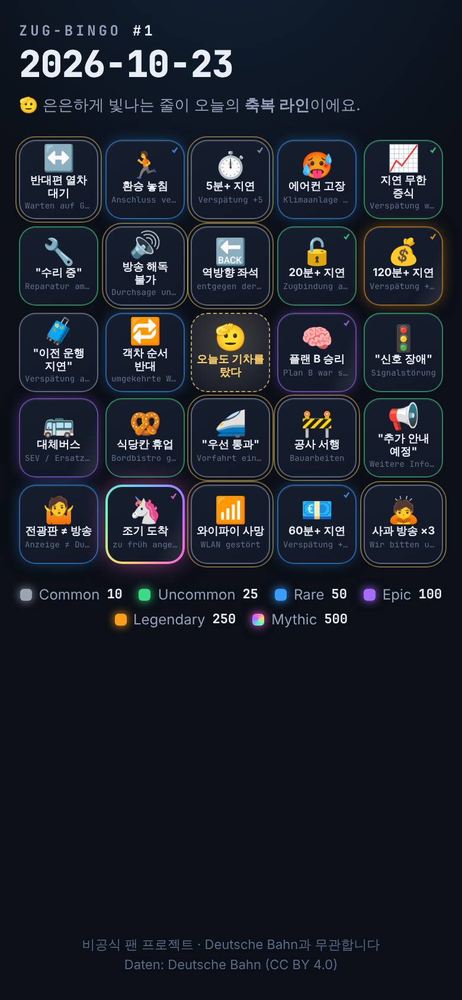
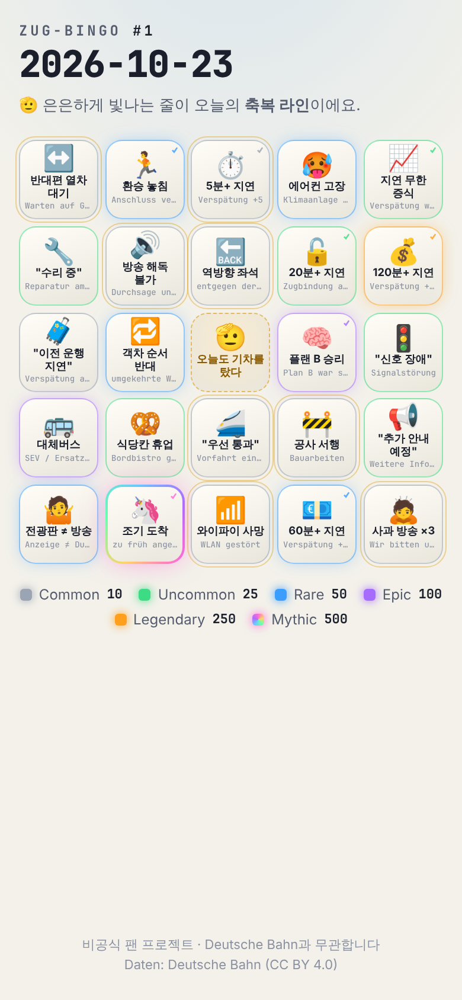

# Phase 0 보고서 — 기획 고정 + 게임 코어

> 상태: ✅ 완료 · 다음 Phase 진행 전 **승인 대기**

## 1. 만든 것

| 영역 | 파일 | 내용 |
|---|---|---|
| 프로젝트 | `package.json`, `vite.config.ts`, `tsconfig.json` | Vite 8 + TypeScript 6 + vite-plugin-pwa + Vitest 5 |
| 규칙 문서 | `CLAUDE.md` | 절대 규칙, 구조, 명령어, 게임 코어 계약, 톤 가이드, **디자인 원칙** |
| 게임 데이터 | `config/game.yaml` | 보드 5×5, 무료 칸, Daily 시간대/epoch, 인증 배수, 빙고 보너스 |
| | `config/squares.yaml` | **41칸** = HANDOFF 23 + 오리지널 18 |
| | `config/rarity.yaml` | 6등급(점수·색·글로우·공유 이모지·기본 확률) + Daily 구성/배치 규칙 |
| | `config/achievements.yaml` | 업적 11 · 칭호 7 · 레벨 5 |
| 설정 검증 | `app/config/schema.ts` | 모든 문제를 한 번에 보고하는 교차 검증 (미지 등급, implies 대상, 구성 합계/풀 크기, 줄 제약 실현 가능성, 업적 조건 문법 …) |
| 게임 코어 | `app/game/*` | 아래 2장 |
| 밸런스 | `scripts/balance-report.ts`, `app/game/simulate.ts` | Monte Carlo 난이도 리포트 |
| 디자인 프리뷰 | `index.html`, `app/main.ts`, `app/styles.css` | 오늘의 카드 읽기 전용 렌더 (Phase 1 UI의 시각 방향 확인용) |
| 테스트 | `tests/*.test.ts` | **201개 통과** |

## 2. 게임 코어

| 모듈 | 핵심 |
|---|---|
| `rng.ts` | `cyrb128` 해시 → `sfc32` PRNG. 문자열 seed로 완전 결정적 |
| `date.ts` | **Europe/Berlin 00시** 기준 날짜 키 (서머타임 안전), `#N` = epoch(2026-10-23)부터 일수 + 1 |
| `card.ts` | seed `daily:YYYY-MM-DD#v{generator_version}` → 등급별 정확한 개수 추출 → 배치 제약 충족 |
| `bingo.ts` | 가로 5 · 세로 5 · 대각선 2 · 블랙아웃 + "한 칸 남음" 힌트 (`oneAway`) |
| `marks.ts` | 체크/해제, **implies 연쇄** (120분 지연 ⇒ 60/20/5분 자동 체크), auto 인증은 self로 강등되지 않음 |
| `score.ts` | `round(등급 점수 × 1.5|1.0)` 합 + 줄 보너스 50 + 블랙아웃 1000 (전부 config) |
| `achievements.ts` | `stat / square / rarity / line_trips / station_visits / all` 조건 평가, 레벨·진행률 |

**결정성 보장 장치**
- 칸 풀을 id 정렬 후 추출 → YAML 순서를 바꿔도 카드 불변 (테스트 있음)
- 2026-10-23 카드를 스냅샷으로 고정 → 의도치 않은 알고리즘 변경 시 테스트 실패
- 생성 로직 변경 시 `generator_version`을 올리도록 seed에 포함

## 3. 밸런스 리포트 요약 (30일)

전체 표: [`reports/balance-30d.md`](./balance-30d.md) · 튜닝 전: [`reports/balance-30d-v0-before-tuning.md`](./balance-30d-v0-before-tuning.md)

모델: 각 칸이 하루에 독립적으로 발생 (Common 55% · Uncommon 30% · Rare 12% · Epic 5% · Legendary 2% · Mythic 1%), implies 전파, 카드당 20,000회 시뮬레이션.

| 지표 | v0 (튜닝 전) | **v1 (현재)** |
|---|---:|---:|
| 구성 C/U/R/E/L/M | 7/6/6/3/1/1 | **9/6/5/2/1/1** |
| 🫡 축복 라인 | 없음 | **2줄** |
| 하루 1줄 이상 확률 | 2.3% (0.5–10%) 🧊 | **20.0% (16.9–22.7%)** 🙂 |
| 하루 2줄 이상 | 0.0% | 1.3% |
| 주 5일 통근 시 주간 1줄 이상 | 10.9% | **67.3%** |
| 하루 기대 체크 칸 | 6.7 | 7.7 / 24 |
| 30일 중 난이도 "적정" 일수 | 0 / 30 | **30 / 30** |

### 발견 → 조치

1. **v0는 너무 어려웠다.** 고등급 칸을 줄마다 흩어 놓았더니 *모든* 줄에 Rare 이상이 섞여, 하루에 빙고 1줄 확률이 2%대. Wordle식 "오늘 몇 줄?" 공유가 성립하지 않는 수준.
2. **🫡 축복 라인 (blessed lanes) 도입** — 무료 칸 "오늘도 기차를 탔다"를 지나는 4개 줄(가로·세로·두 대각선) 중 2개를 매일 골라 **Common만** 배치. 무료 칸 덕분에 4칸만 채우면 되므로 줄당 ~9%, 두 줄 합쳐 하루 ~20%.
   - 어느 2줄인지는 날마다 바뀜 (6가지 조합 모두 등장 — 테스트로 확인)
   - UI에서 은은한 금색 테두리로 "오늘의 현실적인 목표"를 보여주는 게임 장치가 됨 → 첫 방문자도 바로 목표가 생김
3. **Common 풀 확장** (10 → 13): 축복 라인이 Common 8칸을 쓰므로 매일 같은 칸만 나오지 않도록 오리지널 3칸 추가 (방송 해독 불가 · 역방향 좌석 · 콘센트 정전). 30일간 모든 daily 칸이 최소 10회 이상 등장.
4. **줄 제약**: Epic 이상 줄당 최대 1, Rare 이상 줄당 최대 3. 배치는 seed 기반 백트래킹으로 항상 해를 찾음 (120일 연속 테스트).

### 한계 / 다음에 볼 것
- 기본 확률은 "평범한 통근자의 하루" 감(感) 추정치. Phase 3에서 Bahn-Wetter 확률/실데이터로 칸별 `probability`를 덮어쓰면 리포트를 다시 돌려 재튜닝.
- 실제 지연은 상관관계가 강함 (60분 지연인 날은 환승 놓침·사유 변경도 같이 옴) → 실제 체감 난이도는 시뮬레이션보다 **약간 쉬울** 가능성. 목표 범위(10–35%)는 테스트로 고정해 둠.
- Legendary/Mythic이 30일 중 각 칸 13–17회 등장 → 도감 수집 페이스는 Phase 2에서 업적과 함께 재점검.

## 4. 오리지널 칸 18개 (제안)

| 등급 | 칸 |
|---|---|
| ⚪ Common | 🧳 "이전 운행 지연" 안내 · ↔️ 반대편 열차 대기 · 🚧 공사 구간 서행 · 🚪 하필 내 앞 문만 고장 · ☕ 커피 머신 고장 · 🔊 안내방송이 하나도 안 들림 · 🔙 역방향 좌석 · 🔌 콘센트 정전 |
| 🟢 Uncommon | 🚻 화장실 사용 불가 · 📢 "추가 안내 예정"… 끝내 안 옴 · 📈 지연 시간이 계속 늘어남 (✅) · 🥫 통로까지 만석 |
| 🔵 Rare | 🤷 전광판 ≠ 방송 · 👻 내 예약 객차 실종 · 🐄 선로 위 동물 · 🔄 지연 사유가 중간에 바뀜 |
| 🟣 Epic | 💨 정차 예정역 통과 (✅) |
| 🌈 Mythic | 🦄 예정보다 일찍 도착 (✅) |

모든 칸은 시스템·인프라·안내를 풍자하고 사람을 탓하지 않음 (`flavor` 한 줄 위트 포함, 예: *"신호 장애였다가, 선행 열차였다가, 이제는 날씨입니다."*). 인명사고 관련 소재는 의도적으로 제외.

## 5. 디자인 방향 (프리뷰)

콘셉트 **"심야 승강장 × 트레이딩 카드"** — 무채색 크롬 위에 색은 등급만 쓴다.

| 다크 (기본) | 라이트 ("아침 승강장") |
|---|---|
|  |  |

- 셀 = 미니 트레이딩 카드: 등급 테두리 + Rare 이상 글로우, Epic 이상 홀로그램 쉬머, **Mythic은 회전하는 무지개 conic 테두리**
- 카드가 "딜링"되듯 순서대로 등장하는 진입 애니메이션 (`prefers-reduced-motion` 시 끔)
- 셀용 짧은 이름 `short` 필드 추가 (≤10자) — 긴 정식 명칭은 상세 시트에서
- 숫자·원어·카드 번호는 모노스페이스(전광판 감성), 본문은 Pretendard 계열
- DB 레드 계열 미사용, 비공식 고지 + `Daten: Deutsche Bahn (CC BY 4.0)` footer

## 6. 명령어

```bash
npm install
npm test                    # 201 tests
npm run typecheck
npm run report:balance      # 30일 리포트 (-- --days 60 --from 2026-12-01 --out reports/x.md)
npm run dev                 # 디자인 프리뷰
```

## 7. 다음: Phase 1 (MVP) 계획

1. **카드 화면 인터랙션** — 탭 → 체크 (등급별 햅틱 패턴), 길게 누르기 → 칸 상세 시트(정식 명칭·원어·flavor·인증 방식), 빙고 줄이 *그어지는* 애니메이션, "한 칸 남음" 하이라이트
2. **하단 엄지 영역 액션바** — 공유 · 오늘 점수 · 도움말 (상단은 정보 전용)
3. **IndexedDB 오프라인 저장** (`app/storage/`) — 날짜별 체크 상태, 연속 참여 🔥 계산
4. **Wordle식 텍스트 공유** — `Zug-Bingo #N 🚆 2줄!` + 등급 이모지 그리드, Web Share API → 클립보드 fallback
5. **Funkloch 토스트** — `offline` 이벤트 시 토스트 + `funkloch` 칸 자동 체크(오늘 카드에 있으면)
6. **PWA 완성** — 아이콘 세트, 오프라인 프리캐시 검증, 설치 유도
7. YAML을 빌드 타임에 JSON으로 변환해 런타임 `yaml` 파서 제거 (번들 130KB → 약 40KB 예상)

**확인 부탁드릴 것**
- 🫡 축복 라인 규칙 (하루 1줄 확률 ~20% 목표) — 더 쉽게/어렵게 원하시면 `rarity.yaml`의 `blessed_lanes`·`composition`만 바꾸면 됩니다
- 빙고 보너스 (줄당 50, 블랙아웃 1000) — HANDOFF에 없던 제안값
- 오리지널 칸 18개 문구/등급
- 디자인 방향 (다크 퍼스트 · 등급 색 독점 · Mythic 무지개 테두리)
