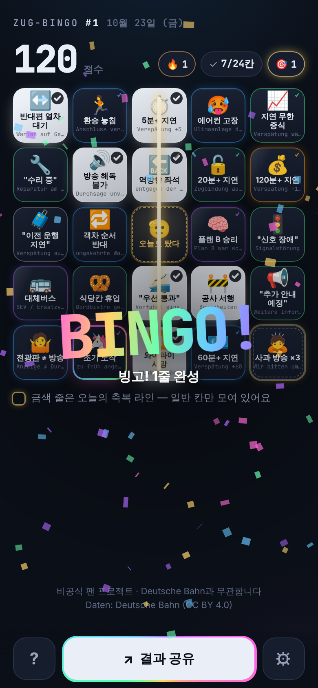
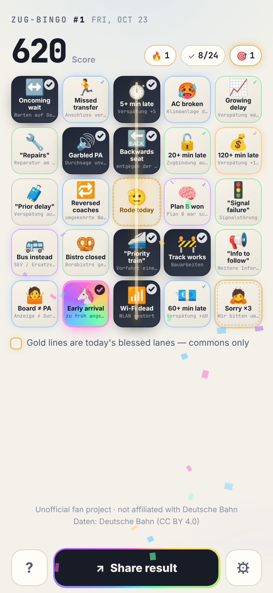
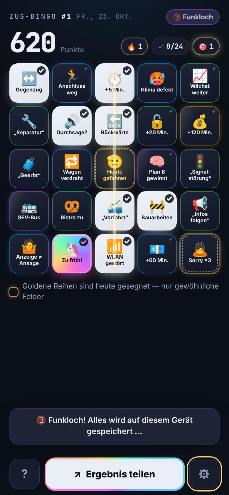
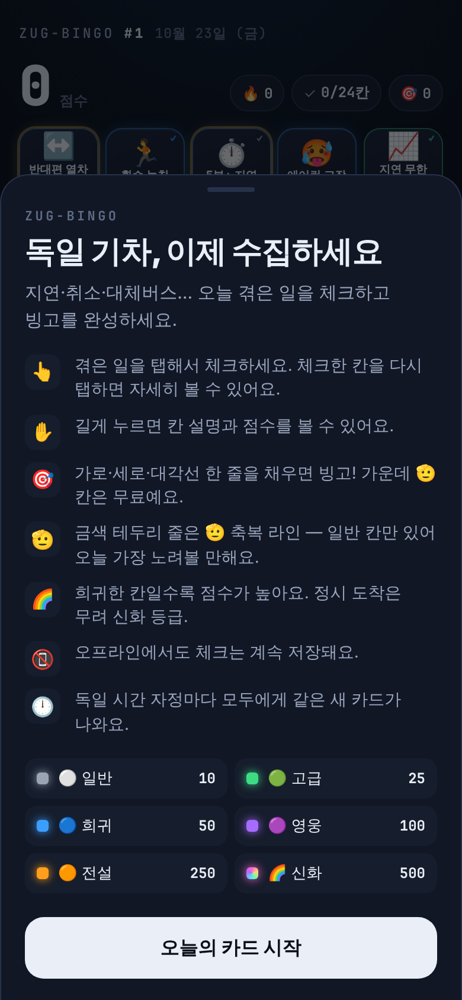
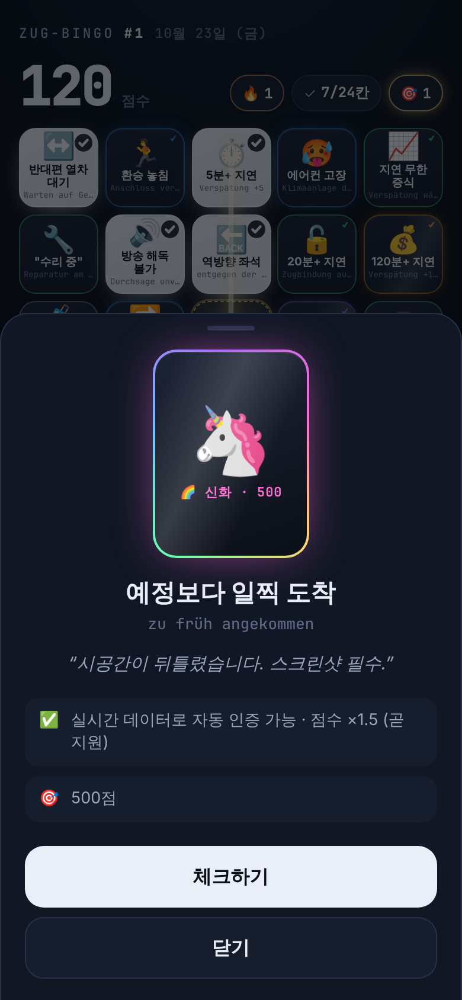
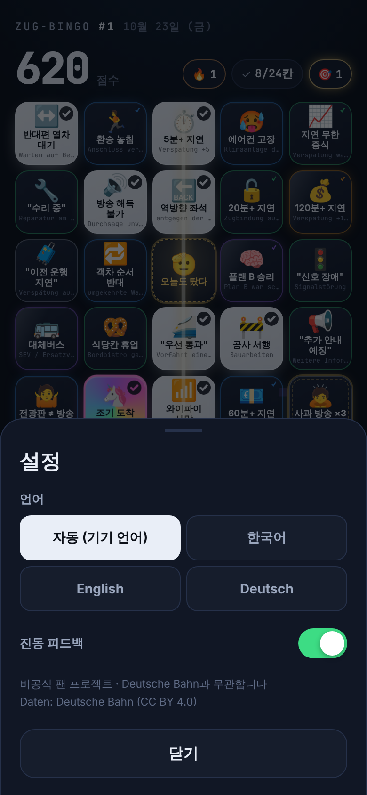

# Phase 1 보고서 — MVP (오늘의 카드 · 오프라인 · 공유 · 3개 언어)

> 상태: ✅ 완료 · 다음 Phase 진행 전 **승인 대기**

## 1. 요약

| 항목 | 결과 |
|---|---|
| 오늘의 카드 UI | 탭 체크 · 다시 탭/길게 눌러 상세 · 빙고 줄 애니메이션 · "한 칸 남음" 힌트 · 🫡 축복 라인 표시 |
| 셀프 체크 | 체크/해제, implies 연쇄 (120분 ⇒ 60/20/5분) 토스트 안내 |
| 오프라인 저장 | IndexedDB (칸 id 기준 저장), 사용 불가 시 메모리 폴백 · 서비스워커 프리캐시로 **오프라인 새로고침 확인** |
| Wordle식 공유 | 언어별 문구 + 언어 중립 이모지 그리드, Web Share API → 클립보드 폴백 |
| Funkloch | 오프라인 진입 시 토스트, 오늘 카드에 '통신 두절' 칸이 있으면 자동 획득 + 헤더 📵 배지 |
| 연속 참여 | 🔥 스트릭 (오늘 아직 안 했으면 어제까지의 기록 유지) |
| **다국어 (추가 요청)** | **한국어 · English · Deutsch** — 기기 언어 자동 감지 + 설정에서 수동 전환 |
| 테스트 | **233개 통과** (+32: i18n, 공유, 스트릭, 일별 기록, IndexedDB) |
| 번들 | JS 84 KB (gzip 32 KB) · CSS 18 KB — YAML 파서를 빌드 타임으로 옮겨 Phase 0 대비 −35% |

## 2. 다국어 설계 (요청 반영)

영어/독일어 버전을 **나중에 붙이는 게 아니라 구조로 먼저 고정**했습니다.

```
config/squares.yaml          게임 데이터만 (id, 등급, 인증, term=독일어 원어 …)
config/locales/ko.yaml       기준 언어
config/locales/en.yaml       기기 언어가 미지원일 때 폴백
config/locales/de.yaml       원어 병기 생략 (show_term: false)
```

- **감지 순서**: 설정에서 고른 언어 → 기기 언어(`de-AT` → `de`) → 영어
- **안전장치**: 키 누락, 기준 언어에 없는 키, `{변수}` 불일치, 셀 이름 길이 초과(ko 10 / en·de 16자)는 **빌드·테스트 실패**
- **복수형**: `1 line!` / `2 lines!`, `1 Reihe!` / `2 Reihen!` (Intl.PluralRules)
- **공유 호환**: 카드와 이모지 그리드는 칸 id 기반이라 언어가 달라도 같은 `#번호` 결과를 비교 가능 → 독일 친구와 공유 OK
- 번역은 직역이 아니라 각 언어에서 웃긴 문장으로 새로 씀. 예:
  - 🚌 대체버스 — *"기차표로 떠나는 고속도로 투어."* / *"A motorway tour, included with your rail ticket."* / *"Autobahn-Rundfahrt, im Bahnticket inklusive."*
  - 🐄 선로 위 동물 — *"오늘 선로 통행 우선권은 소에게 있습니다."* / *"Today the cows have right of way."* / *"Heute haben die Kühe Vorfahrt."*
- 등급명: 일반·고급·희귀·영웅·전설·신화 / Common…Mythic / Gewöhnlich…Mythisch

> 💡 "영문이 더 깔끔할 것 같다"는 의견에 대해: 기본값을 **기기 언어 자동**으로 두어 한국어 폰은 한국어, 그 외는 영어로 뜹니다. 영어를 전 세계 기본으로 고정하길 원하시면 `game.yaml`의 `reference`는 ko로 두고 감지 로직만 바꾸면 됩니다 (한 줄 변경).

## 3. 디자인 & 사용성

| 한국어 · 빙고 순간 | English · 라이트 모드 | Deutsch · Funkloch |
|---|---|---|
|  |  |  |

| 첫 실행 온보딩 | 칸 상세 (Mythic) | 설정 |
|---|---|---|
|  |  |  |

**임팩트**
- 체크하면 칸이 등급 색으로 **점등** (Common은 전광판 램프처럼 밝은 흰색 — 회색은 '비활성'처럼 보여서 바꿈), 펀치 애니메이션 + 등급색 물결
- Rare 이상은 칸에서 색종이 버스트, 등급이 높을수록 크게 · Mythic은 무지개 (Phase 2에서 등급별 이펙트 본격 확장)
- 빙고 시 줄이 **그어지고**, 화면 중앙에 `BINGO!` 도장 + 무지개 색종이, 공유 버튼에 회전하는 무지개 테두리 → 공유 유도
- 진동 패턴도 등급별 (config: `rarity.yaml`의 `haptic`)

**사용성**
- 모든 액션은 **하단 엄지 영역** (도움말 · 결과 공유 · 설정), 상단은 정보만 (점수 카운트업, 🔥 스트릭, 체크 수, 빙고 줄 수)
- 실수 방지: 체크된 칸을 다시 탭하면 **바로 해제하지 않고** 상세 시트에서 해제
- 스크롤 중 오체크 방지 (포인터가 10px 이상 움직이면 취소)
- "한 칸 남음" 힌트는 위치가 흔들리지 않게 점선 깜빡임으로만 (움직이는 탭 타깃 금지 규칙을 CLAUDE.md에 추가)
- 키보드: Enter/Space 체크, `i` 상세, Esc 닫기 · 스크린리더용 grid/gridcell 라벨 · `prefers-reduced-motion` 존중
- 자정(독일 시간)이 지나면 앱을 켜둔 상태에서도 새 카드로 교체 + 토스트

## 4. 구조 변경

- `squares.yaml`의 `label/short/flavor/de` → `locales/*.yaml` + `term`으로 이동 (카드 생성 결과는 **불변** — 스냅샷 테스트 통과)
- YAML → 빌드 타임 JSON (`scripts/vite-plugin-yaml.ts`)
- UI 스택: **Preact** (4 KB) — Phase 2의 도감·프로필 화면을 위해 바닐라 대신 선택
- 저장은 칸 **id** 기준 → 나중에 카드 레이아웃이 바뀌어도 수집 기록 유지 (도감 대비)

## 5. 알려진 한계

- iOS Safari는 Vibration API 미지원 → 진동 없음 (시각 이펙트는 동일)
- 폰트는 시스템 폰트 (Apple SD Gothic Neo / Noto Sans KR). Pretendard 자체 호스팅은 용량(서브셋 후에도 수백 KB) 대비 이득을 Phase 2에서 판단
- 공유는 아직 텍스트만 — PNG 카드는 Phase 2

## 6. 다음: Phase 2 (수집 & 성장) 계획

1. **등급별 체크 이펙트 완성** — Common 탭 / Uncommon 펄스 / Rare 스파크 / Epic 홀로 플립 / Legendary 금빛 폭발 / **Mythic 전체 화면 무지개 폭죽**
2. **도감** — 41칸을 등급별 그리드로, 미획득은 실루엣, 획득 횟수·첫 획득일
3. **업적 · 칭호 · 레벨** — 달성 시 토스트 + 프로필에 칭호 선택
4. **프로필 화면** — 레벨 진행 바, 누적 통계, 칭호
5. **1080×1350 공유 PNG** — 캔버스 렌더링, 언어별 문구 (Instagram 세로)
6. 하단 탭 내비게이션 (오늘 · 도감 · 프로필)

**확인 부탁드릴 것**
- 기본 언어 정책: 기기 언어 자동 (현재) vs 영어 고정
- 체크 시 색 "점등" 방식과 빙고 연출 강도
- 영어/독일어 칸 문구 톤 (`config/locales/en.yaml`, `de.yaml`)
