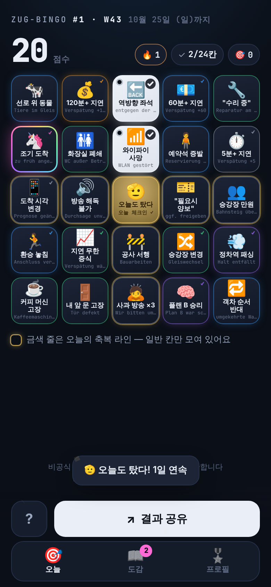
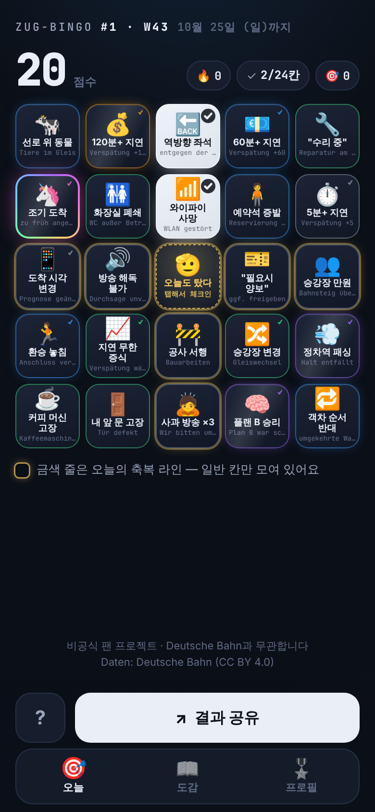
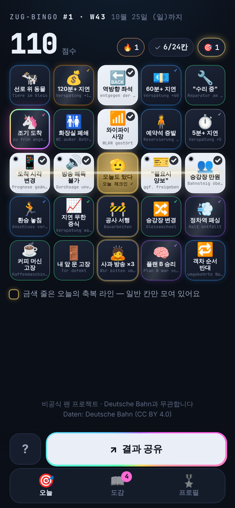
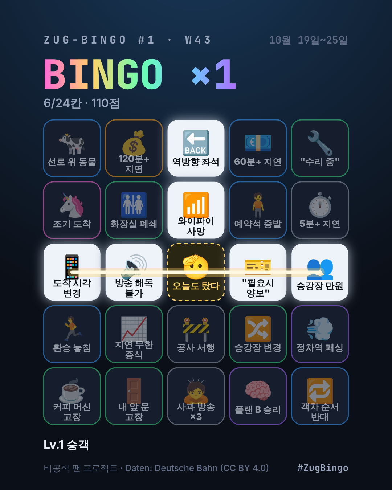

# Phase 2.5 — 현실 확률 반영 & 주간 카드 전환

> 사용자 피드백: "매일 겪기엔 엄청난 일들 아닌가? 그렇게 흔한 걸까?" → 맞았음. 승인 후 추천안(B) 적용.

## 1. 무엇이 문제였나

Phase 0에서 칸 확률을 등급별로 일괄 지정했음 (일반 칸 전부 하루 55%). 커피 머신 고장·역방향 좌석 같은 칸이 매일 절반 이상 일어나지는 않으므로 **과대평가**.

칸 41개(+3)에 **칸별 현실 확률**을 넣고 다시 시뮬레이션:

| | 이전 (부풀린 확률) | 현실 확률 |
|---|---:|---:|
| 매일 5×5 카드 — 하루 빙고 확률 | 20% | **0.9%** |
| 하루에 체크할 칸 수 | 7.7 | **3.1** |

→ 매일 5×5 빙고는 사실상 불가능. 재미가 성립하지 않음.

**확률 근거**
- 지연 계열: DB 장거리 정시율 **2024년 62.5% / 2025년 60.1%** (6분 기준, 역대 최저, 2025년 10월 51.5%)에서 역산 — 하루 왕복 2회 통근자 기준 5분 이상 지연 ≈ 40%
- 나머지: 보수적 추정 (예: 커피 머신 고장 4%, 선로 위 동물 1%) — `config/squares.yaml`의 `probability`, Phase 3 실데이터로 교체 예정
- 원칙(CLAUDE.md에 추가): **확률은 현실값으로 두고, 난이도는 카드 구성·주기로 조절**한다

## 2. 바꾼 것 — 주간 카드가 메인

| | 내용 |
|---|---|
| 카드 | **월~일 한 주에 한 장** (월요일 00시 독일 시간에 모두에게 같은 새 카드), `#번호 · W주차` |
| 체크 | 매일 겪은 일을 체크 → 그 주 카드에 쌓임. 오늘 체크한 칸엔 작은 점 |
| 🫡 매일 체크인 | 가운데 무료 칸을 탭하면 "오늘도 탔다" 체크인 → **아무 일 없던 날도 연속 참여 유지** (금색으로 점등) |
| 칸 정리 | 정말 흔한 일상 3칸 추가 (👥 승강장 인산인해 · 🎫 예약석 '필요시 양보' · 📱 앱 도착 예정 시각 변경), 실제론 덜 흔한 7칸 등급 조정 |
| 공유 | `Zug-Bingo #1 · W43 🚆 1줄!` + "오늘 +2칸", 이미지에 주간 날짜 범위 |
| 통계 | 업적의 '빙고한 날' → **'빙고한 주'**, 줄·점수는 주 단위, 도감·연속 참여는 일 단위 |

## 3. 밸런스 (주간, 통근 5일 누적)

전체: [`balance-weekly.md`](./balance-weekly.md) · 비교용 매일 카드: [`balance-daily-realistic.md`](./balance-daily-realistic.md)

| 지표 | 값 |
|---|---:|
| **주당 1줄 이상** | **53.8%** (주별 49–63%) — 대략 2주에 한 번 빙고 |
| 주당 2줄 이상 | 10.7% |
| 한 주에 체크할 칸 수 | 10 / 24 |
| 블랙아웃 | 사실상 0% (전설급 목표로 유지) |

구성: 일반 9 · 고급 6 · 희귀 5 · 영웅 2 · 전설 1 · 신화 1 + 🫡 축복 라인 2줄 (4가지 구성 비교 후 선택)

## 4. 화면

| 월요일 — 체크인 + 2칸 | 수요일 — 열었을 때 (월요일 기록 유지) | 수요일 — 2칸 더 → 빙고 |
|---|---|---|
|  |  |  |

공유 이미지: 

## 5. 검증

- 테스트 **293개 통과** (+43): 주 계산(ISO 주차, 월요일), 주간 카드 결정성·구성(26주), 여러 날에 걸친 체크 저장/해제/자동인증 승격, 체크인, 주를 넘으면 줄이 이어지지 않음, 체크인만 한 날도 연속 참여
- 실제 브라우저에서 시계를 월 → 수 → 다음 주 월로 옮기며 확인: 월요일 기록 유지, 수요일 빙고, 다음 주 새 카드(#2 · W44) + 토스트, 프로필 '빙고한 주 1'
- `generator_version` 1 → 2 (칸 풀 변경으로 같은 날짜의 카드가 달라졌기 때문)

## 6. 남은 판단

- Daily 카드 코드는 그대로 있음 (`card.period: day`로 되돌릴 수 있음). 나중에 "오늘의 3×3 미니 카드" 같은 보조 모드로 재활용 가능
- 확률은 여전히 추정치 → Phase 3에서 실시간 데이터로 실제 발생률을 모아 재보정
