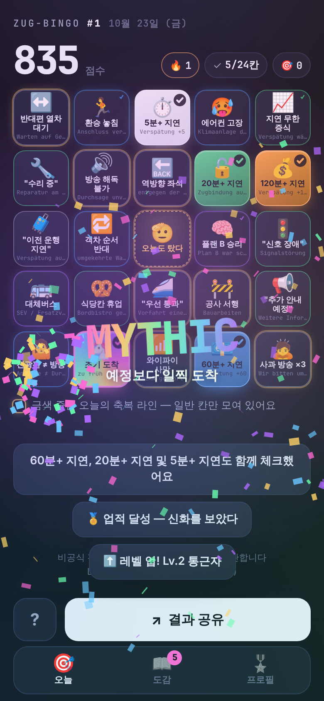
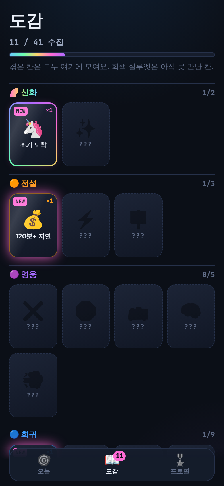
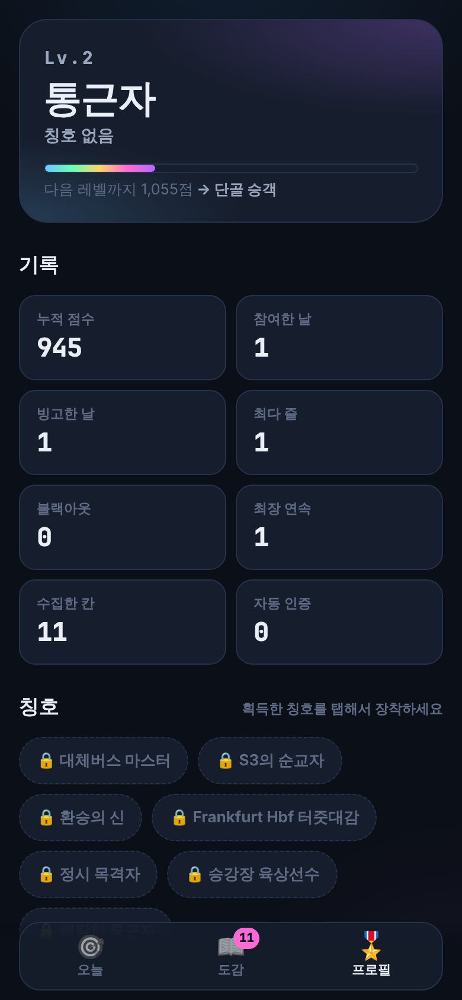
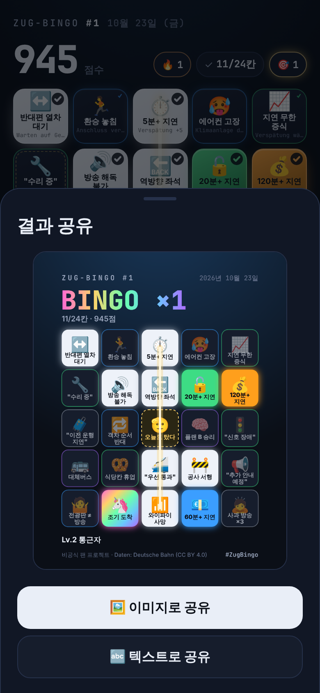
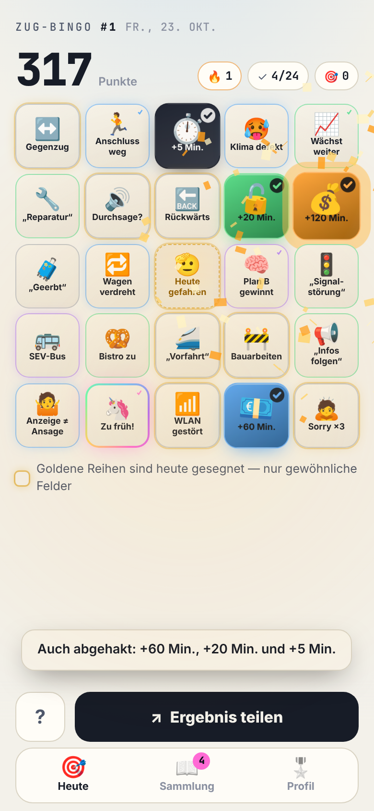
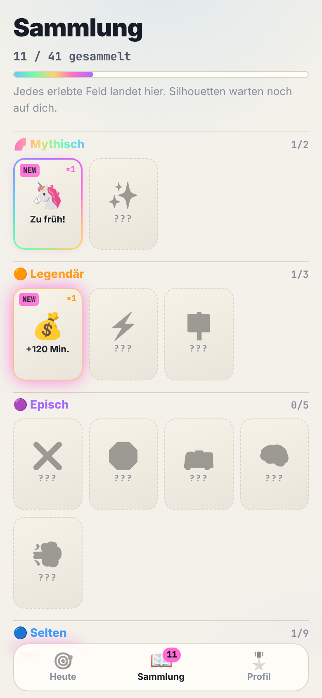
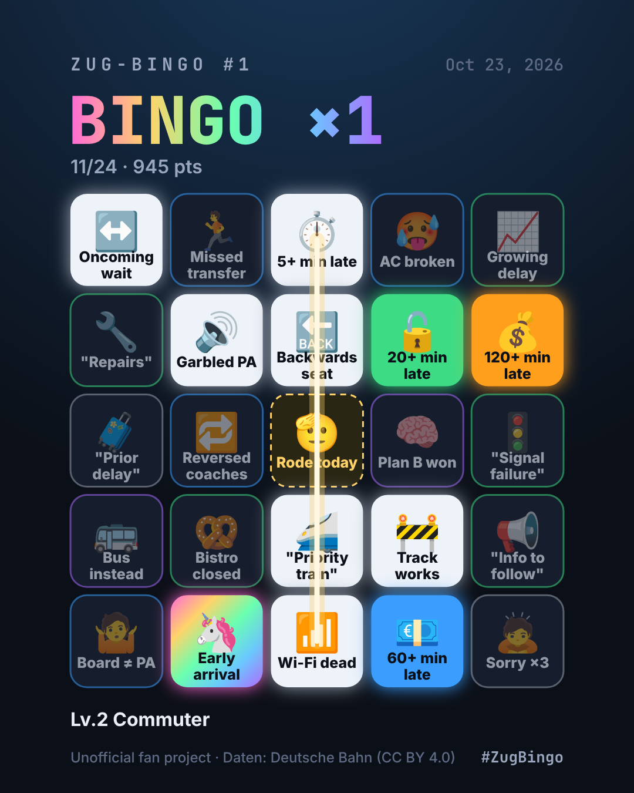
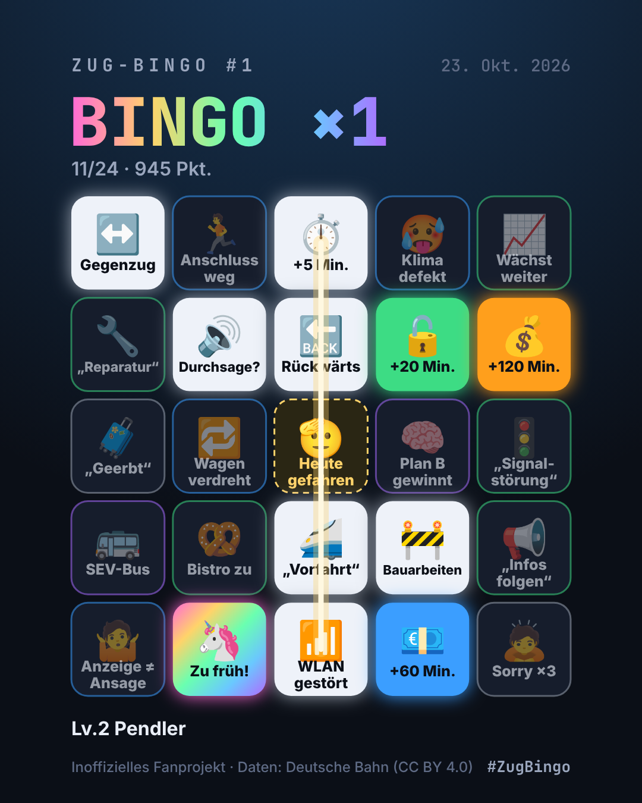

# Phase 2 보고서 — 수집 & 성장

> 상태: ✅ 완료 · 다음 Phase 진행 전 **승인 대기**

## 1. 요약

| 항목 | 결과 |
|---|---|
| 등급별 체크 이펙트 | `rarity.yaml`의 `effect`로 6단계 — tap · pulse · spark · **holo 카드 뒤집기** · **gold 화면 플래시** · **Mythic 무지개 폭죽 + `MYTHIC` 연출** |
| 도감 | 41칸 등급별 그리드, 미획득은 실루엣 `???`, 획득 횟수 · 첫 획득일, 새로 얻은 칸 `NEW` + 탭 배지 |
| 업적 · 칭호 · 레벨 | 달성 순간 토스트 (🏅 업적 / 🎖️ 칭호 / ⬆️ 레벨 업), 칭호 장착, 레벨 진행 바 |
| 프로필 | 레벨 카드, 누적 기록 8종, 칭호, 업적 11종, 설정 · 도움말 |
| 공유 PNG | **1080×1350** 캔버스 카드 + 미리보기 시트 → 공유 시트(파일) / 미지원 시 다운로드, 텍스트 공유 유지 |
| 내비게이션 | 하단 탭 (오늘 · 도감 · 프로필) — 공유 버튼은 '오늘' 탭에서 탭 바 바로 위 |
| 테스트 | **250개 통과** (+17: 통계 집계, 메타 저장, 공유 이미지 레이아웃, 텍스트 줄바꿈) |
| 번들 | JS 105 KB (gzip 38 KB) · CSS 27 KB (gzip 7 KB) |

## 2. 화면

| 신화 획득 순간 | 도감 | 프로필 |
|---|---|---|
|  |  |  |

| 공유 시트 (미리보기) | Deutsch · 라이트 · 전설 획득 | Deutsch · 라이트 · 도감 |
|---|---|---|
|  |  |  |

**공유 이미지 (1080×1350)** — 언어별로 문구가 바뀌고 그리드는 동일

| 한국어 | English | Deutsch |
|---|---|---|
|  |  |  |

## 3. 설계 포인트

**이펙트 위계 (CLAUDE.md 피드백 위계 원칙 구현)**

| 등급 | effect | 셀 | 화면 | 진동 |
|---|---|---|---|---|
| ⚪ 일반 | tap | 펀치 + 물결 | — | 12ms |
| 🟢 고급 | pulse | 굵은 물결 | 작은 파티클 | 18ms |
| 🔵 희귀 | spark | 펀치 | 스파크 28개 | 3박 |
| 🟣 영웅 | holo | **3D 카드 뒤집기** | 파티클 44개 | 5박 |
| 🟠 전설 | gold | 금빛 링 확산 | **금빛 화면 플래시** + 80개 | 5박 |
| 🌈 신화 | rainbow | 뒤집기 + 회전 무지개 | **무지개 플래시 + 폭죽 6발 + `MYTHIC`** | 7박 |

- 신화와 빙고가 동시에 터지면 `MYTHIC` → 1.6초 뒤 `BINGO!` 순서로 연출이 겹치지 않게 처리
- `prefers-reduced-motion`이면 파티클·플래시 생략

**성장 시스템**
- 통계는 저장된 날짜 기록에서 **매번 다시 계산** (`app/game/stats.ts`, 순수 함수) → 별도 누적값이 없어 데이터가 어긋날 일이 없음
- 칸 획득 수는 기록의 칸 id에서 직접 셈 → 카드 생성 규칙이 바뀌어도 도감은 유지
- 업적 알림 중복 방지: 이미 달성한 항목을 IndexedDB에 기록, Phase 1 사용자가 업데이트해도 **기존 업적이 한꺼번에 쏟아지지 않음**
- 체크를 해제해도 이미 받은 업적·칭호는 회수하지 않음 (다시 알림도 없음)

**공유 이미지**
- 독일어 긴 단어가 글자 단위로 잘리던 문제 → 단어 단위 줄바꿈 + soft hyphen 지점에서만 `-`로 끊고, 그래도 넘치면 **글자 크기를 자동으로 줄임** (테스트 포함)
- 하단에 레벨 · 장착 칭호 표시, 비공식 고지 + `Daten: Deutsche Bahn (CC BY 4.0)` 고정

## 4. 알려진 한계

- 누적 지연 시간 · 보상금 · 베팅 업적(`delay_24h`, `compensation_100`, `oracle_5`)과 노선 · 역 칭호(`S3의 순교자`, `Frankfurt Hbf 터줏대감`)는 Phase 3/4 데이터가 들어와야 달성 가능 — 프로필에 잠김으로 표시됨
- 데스크톱 브라우저 등 파일 공유 미지원 환경은 PNG 다운로드로 대체
- 캔버스 글꼴은 기기 시스템 글꼴 (Pretendard 미탑재)

## 5. 다음: Phase 3 (실시간 인증) 계획

1. **Cloudflare Workers 프록시** (`worker/`) — DB API Marketplace Timetables API (plan / fchg / rchg), API 키는 `wrangler secret`으로만, 응답 캐싱 + 레이트 리밋
2. **자동 인증** (`app/verify/`) — 열차번호 + 날짜 + 역 → 지연 분, 취소, 승강장 변경 판정 → ✅ 인증 도장 애니메이션, 점수 ×1.5
3. **내 여정 (Trip) 카드** — 열차번호/구간 입력 → 노선 특성 반영 카드 (Bahn-Wetter 확률 JSON이 없으면 기본 테이블)
4. **예측 베팅** — 정시 / 5–19 / 20–59 / 60+ / 취소, 배당 = 확률의 역수, **게임 포인트 전용**, 하차 후 자동 정산
5. 오프라인 중 체크 → 연결 시 자동 인증 동기화

**Phase 3 진행에 필요한 것 (사용자 확인)**
- DB API Marketplace 계정의 **Client ID / API Key** — 제가 볼 필요 없이 Cloudflare에 `wrangler secret put`으로 직접 넣으시면 됩니다
- Cloudflare 계정 (Workers 배포용) — 없으면 로컬 `wrangler dev` + 모의 응답으로 먼저 개발 가능
- Bahn-Wetter 확률 JSON이 있다면 경로/형식
